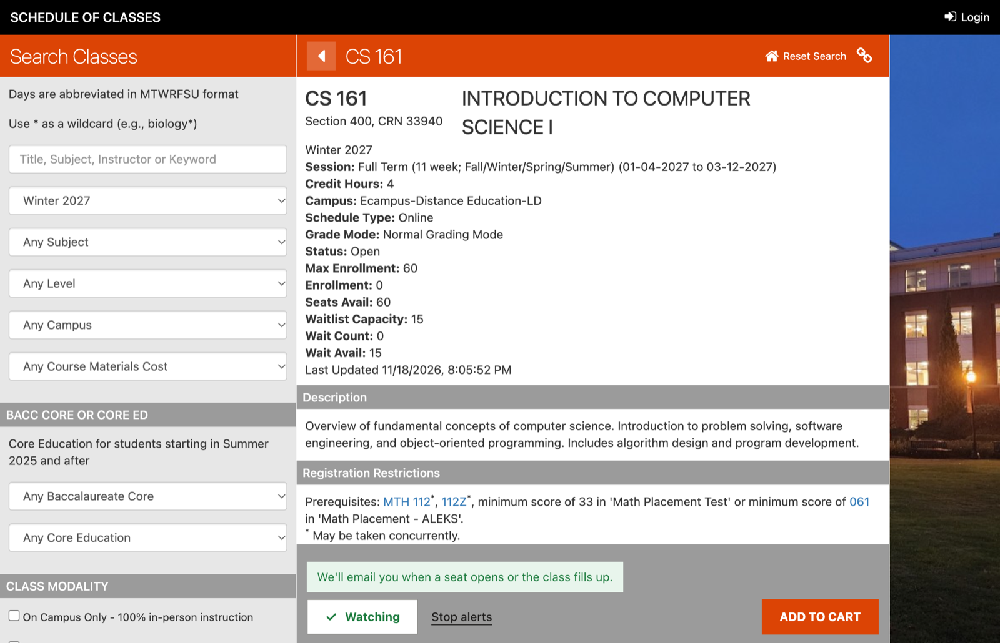

# GetTheDamClass

Class vacancy notifier Chrome extension for Oregon State University.

On [classes.oregonstate.edu](https://classes.oregonstate.edu), open a class and press **Notify me**: you get an email when a seat opens or the class fills up. **Stop alerts**, next to it, turns that off again. The toolbar popup lists the classes you are watching and lets you stop the alerts there too.

| On the class page | In the toolbar popup |
| --- | --- |
|  |  |

Alerts cover the classes of **one term at a time** (right now Winter 2027), because that is what the backend watches. On a class of any other term the page shows a short note instead of the button. See [Each term](#each-term).

We have a backend server running on a private VPS to track course vacancies and alert students. The backend code can be found [here](https://github.com/aj-arts/GetTheDamClass-Backend).

## Adding the Chrome Extension

1. Download the latest release from the [releases page](https://github.com/colinpannikkat/GetTheDamClass/releases).
2. Extract the downloaded zip file to a location on your local machine.
3. Open Chrome and navigate to `chrome://extensions`.
4. Enable "Developer mode" by toggling the switch in the top right corner.
5. Click on the "Load unpacked" button and select the extracted folder.
6. The extension should now be added to Chrome and ready to use.

**Updating from an earlier version** (including version 1): extract the new zip over the old folder and press the reload button on the extension's card. That keeps you signed in. If you extract to a new folder instead, Chrome treats it as a different extension: remove the old GetTheDamClass first (otherwise the class page gets two buttons) and sign in again.

We will hopefully have it released on the Chrome Web Store soon!

## Building it yourself

You need [Node.js](https://nodejs.org) 22.23, 24.22 or 26.12 (or newer within that line; developed with 24) and [pnpm](https://pnpm.io/installation). Those are the versions [cf](https://developers.cloudflare.com/cf/), Cloudflare's command-line tool, supports; it builds the server.

```sh
pnpm install
pnpm build
```

The extension is written to **`apps/extension/.output/chrome-mv3`**. Load that folder in Chrome: `chrome://extensions` → enable "Developer mode" → "Load unpacked".

### Scripts

Run these in `apps/extension/`. `pnpm typecheck`, `pnpm test` and `pnpm build` also work from the repository root, where they run in every package.

| Command | What it does |
| --- | --- |
| `pnpm dev` | Development build into `.output/chrome-mv3-dev` that rebuilds and reloads as you edit. Load that folder once with "Load unpacked". (It asks for extra permissions that WXT needs for reloading; the real build does not.) |
| `pnpm build` | Production build into `.output/chrome-mv3`. |
| `pnpm zip` | Builds, then packs the result into a zip in `.output/` for a release or the Chrome Web Store. |
| `pnpm typecheck` | Checks the TypeScript types. |
| `pnpm test` | Runs the unit tests. |

### Running the server

`apps/server` is a Cloudflare Worker that will replace the backend. For now it only answers `GET /` with a hello.

```sh
cd apps/server
pnpm dev                       # runs the Worker locally, at http://localhost:5173
```

`pnpm dev` keeps running. From a second terminal:

```sh
curl http://localhost:5173/    # {"message":"Hello from GetTheDamClass"}
```

`pnpm dev` (`cf dev`) runs the Worker in workerd, the same runtime Cloudflare uses, and reloads it as you edit. `pnpm typecheck`, `pnpm test` and `pnpm build` work there as they do in the extension.

## How it is built

- [WXT](https://wxt.dev) builds the extension and generates `manifest.json` (from `apps/extension/wxt.config.ts` and the files in `apps/extension/entrypoints/`).
- [React](https://react.dev) and [Tailwind CSS](https://tailwindcss.com) draw the user interface.
- [Effect](https://effect.website) runs everything that is not drawing: talking to the backend, storage, and error handling.
- [Vitest](https://vitest.dev) runs the tests. They sit next to the file they test (`Api.ts` → `Api.test.ts`).

## Project map

```
apps/extension/           The browser extension.
  entrypoints/            What the browser loads. WXT turns each folder into part of the extension.
    popup/                The window that opens from the toolbar icon.
      App.tsx             Picks the screen: signed out, or signed in with the list.
      ClassList.tsx       The watched classes, each with its "Stop" button.
    content/              The script added to classes.oregonstate.edu.
      index.tsx           Puts a control into every class-details panel and keeps it there.
      detailsPanel.ts     Everything we know about the page's HTML. START HERE when the
                          university changes its markup and the button disappears.
      NotifyControl.tsx   The "Notify me" button, "Stop alerts", their messages and the sign-in popover.
      fixtures/           Trimmed copies of the real page, for the tests.
    signin/               The sign-in form the class page shows in a frame (see below).
  components/             React components shared by the popup and the pages above.
    Button.tsx            A button with variants and a loading state.
    Message.tsx           An inline info, success or error message.
    TextField.tsx         A text input with its label.
    SignInForm.tsx        Email + PIN form that signs in (or signs up).
    cx.ts                 Tiny helper to join CSS class names.
  lib/                    Everything that is not user interface.
    domain.ts             The data types (Credentials, Crn, Subscription) and every error.
    term.ts               The one term alerts work for. Changed every term.
    Api.ts                Service: the calls to the backend.
    AccountStore.ts       Service: the saved email and PIN and the list of watched classes,
                          in the browser's extension storage.
    workflows.ts          What a user can do: signIn, signOut, subscribe, unsubscribe, listSubscriptions.
    runtime.ts            Wires the real services together so effects can run.
    react.ts              Hooks that let React components run effects.
    errorMessage.ts       The sentence shown to the user for each error.
  assets/tailwind.css     The stylesheet: colours and sizes used everywhere.
  public/icons/           The extension's icons, copied into the build as they are.
  wxt.config.ts           Extension name, permissions, icons; build plugins.
  vitest.config.ts        Test setup (with vitest.setup.ts).
apps/server/              The Cloudflare Worker that will replace the backend. Only a hello for now.
  src/Api.ts              The endpoints, defined with Effect's HttpApi.
  src/index.ts            The Worker: answers each request with the handlers for those endpoints.
  cloudflare.config.ts    The Worker's name and settings for Cloudflare.
  vite.config.ts          Builds and runs the Worker, with Cloudflare's Vite plugin.
  vitest.config.ts        Test setup.
```

There is no background script. The extension only needs the `storage` permission, and no access to any website beyond the content script on the class search.

### How the parts stay in step

The popup, the button on the class page and the sign-in frame all read and write the browser's extension storage (`apps/extension/lib/AccountStore.ts`): who is signed in, and which CRNs they are watching. Each of them follows it as it changes, so stopping an alert in the popup turns "Watching" back into "Notify me" on an open class page, and signing in anywhere signs you in everywhere.

What is stored, unencrypted, until you sign out (which removes all of it):

| Key | Value | |
| --- | --- | --- |
| `email` | `"student@oregonstate.edu"` | The same two keys version 1 used, so its users stay signed in when the extension is updated in place. |
| `pin` | `"1234"` | |
| `watch:202702:student@oregonstate.edu:33940` | `true` | One key per watched class, named after the term, the account and the CRN. |

A watched class is a key of its own so that adding one is a single write and removing one a single delete. Nothing reads a list, changes it and writes it back, so two changes made at the same moment (in the popup and on a class page, say) cannot undo each other. And the account is part of the name so that an answer from the server that arrives after someone else signed in is saved for the account that asked, where the other never sees it. The term is part of the name so that last term's saved classes stop counting as watched when `apps/extension/lib/term.ts` moves on (the next term can reuse a CRN for a different class). That only covers what this browser saved: the server's list carries no term, so the old alerts must also be cleared in the backend (see [Each term](#each-term)).

One known gap: if you sign out while a "Notify me" request is still waiting for the server, its answer is saved after the sign-out, leaving one `watch:` key (email and CRN, no PIN) until the next sign-out.

The page trusts that saved list and does not ask the server when a class is opened. If an alert was stopped elsewhere (the Unsubscribe link in an email, another browser), the page still says "Watching" until the popup is next opened, which fetches the real list, or until "Stop alerts" is pressed, which works either way.

### Why the sign-in form on the class page is in a frame

Whatever a content script draws into a web page, that page's own scripts can read, including every key typed into a field. So the email and PIN are never typed into the university's page. The popover that "Notify me" opens contains an `<iframe>` showing `signin.html`, a page of the extension itself (`apps/extension/entrypoints/signin/`). The class page cannot look inside it. `apps/extension/wxt.config.ts` lists that one page under `web_accessible_resources`, for classes.oregonstate.edu only, which is what allows it to be framed there.

The frame tells the page around it three things, with `window.postMessage` (`apps/extension/entrypoints/signin/messages.ts`): "close me" (Escape was pressed), "I am this tall now", and "signed in". None of them carries what was typed. "Signed in" is what makes the button carry on and set up the alert, so only the form that was actually submitted does that: signing in through the toolbar popup while a popover is open on a class page subscribes to nothing.

### When the university changes its page

The button is only put on the page when the script can read three things from a class's panel: the CRN, the term, and the bar that holds ADD TO CART. If one of them cannot be found the script shows nothing, rather than a button that might sign a student up for the wrong class. So after a change to the university's markup the button simply disappears.

`apps/extension/entrypoints/content/detailsPanel.ts` holds every selector, with a drawing of the page's structure at the top. Its tests run against `apps/extension/entrypoints/content/fixtures/*.html`. To refresh a fixture: open the section on classes.oregonstate.edu, and in the browser's developer tools run `copy(document.querySelector("main.panels").outerHTML)`. Paste that over the fixture and trim it the way the comment at the top of the file describes. Then run `pnpm test` and fix `detailsPanel.ts` until it passes.

## Each term

The backend looks up classes in one hard-coded term (`'term': '202702'` in its `app/loop.py`, three places), and its API cannot tell terms apart: it is sent a bare CRN, and the same number can be a different class in another term. The extension therefore offers alerts only for sections whose term it can read from the page and which is exactly the one named in `apps/extension/lib/term.ts`. When registration for the next term is about to open:

1. In `apps/extension/lib/term.ts`, change `code` (the `srcdb` value the class search uses, for example `202703`) and `label` ("Spring 2027").
2. Bump `version` in `apps/extension/package.json` and publish the extension (see [Releasing](#releasing)).
3. Once the new version is out, change the term in the backend and deploy it.

Do step 3 soon after step 2. The two can never switch at the same instant (browsers pick up a new version of an extension over hours or days), and while they disagree a press is looked up in the wrong term. Releasing the extension first, during the quiet days before registration opens, keeps that to a minimum.

People who installed from a release zip ("Load unpacked") do not get updates automatically: until they download the new release, the page keeps telling them alerts cover the old term only. Say so in the release notes.

Alerts set up for the old term stay in the backend's database, and its API does not say which term an alert belongs to. Clearing them out is a required part of step 3, not a tidy-up: until they are gone, their CRNs are looked up in the new term, and opening the popup lists them and marks them as watched, so a new class that reuses one of those numbers shows "Watching".

## Releasing

1. Bump `version` in `apps/extension/package.json` (the manifest takes its version from there).
2. `pnpm typecheck && pnpm test`
3. `pnpm zip` in `apps/extension/`, which writes `apps/extension/.output/getthedamclass-<version>-chrome.zip`.
4. Attach the zip to a new release on GitHub (and upload it to the Chrome Web Store once the extension is listed there).

## How the Effect code is organised

If you have not used Effect before, this is all you need to find your way around `apps/extension/lib/`.

**An effect is a description of work.** A value of type `Effect<Success, Error, Requirements>` does nothing by itself; it describes something that, when run, either succeeds with a `Success` or fails with one of the listed `Error`s. Because the errors are part of the type, TypeScript tells you which failures you still have to handle.

Inside `Effect.gen(function*() { ... })`, read `yield*` the way you read `await`: it runs another effect and gives you its result.

**Services** are the parts that touch the outside world. There are two:

- `Api` (`apps/extension/lib/Api.ts`) sends requests to the backend.
- `AccountStore` (`apps/extension/lib/AccountStore.ts`) reads and writes the saved email and PIN and the list of watched classes.

Each is a class that names the service and lists its functions. Code asks for one with `const api = yield* Api`.

**Layers** are the implementations of a service. `Api.layer` is the real one, built on `fetch`. Tests swap in others: `Api.layerWithFetch(fakeFetch)` to test the Api itself, or `Layer.mock(Api, { ... })` to give other code a fake backend.

**The runtime** (`apps/extension/lib/runtime.ts`) is where the real layers are put together, once. Anything that wants to run an effect uses it.

**Errors** are all defined in `apps/extension/lib/domain.ts`. Each has a `_tag`, its name as a string (`"WrongPin"`, `"ClassNotFound"`, `"NetworkError"`, ...), so handling an error is a `switch` on `error._tag`. `apps/extension/lib/errorMessage.ts` holds the sentence shown for each one.

**Workflows** (`apps/extension/lib/workflows.ts`) combine the services into the things a user does. `subscribe(crn)`, for example, reads the saved credentials (failing with `NotSignedIn` if there are none), calls the backend with them, and saves the class as watched by that account. The user interface calls workflows, never the services directly.

**Components run effects through three hooks** in `apps/extension/lib/react.ts`. They turn an effect into a plain object with a `status` to switch on:

```tsx
import { Button } from "@/components/Button"
import { Message } from "@/components/Message"
import { errorMessage } from "@/lib/errorMessage"
import { useAction } from "@/lib/react"
import { subscribe } from "@/lib/workflows"

function NotifyButton({ crn }: { crn: string }) {
  const { state, run } = useAction(subscribe)
  return (
    <>
      <Button variant="primary" loading={state.status === "loading"} onClick={() => run(crn)}>
        Notify me
      </Button>
      <Message tone="success">{state.status === "success" ? "You're on the list." : null}</Message>
      <Message tone="error">{state.status === "failure" ? errorMessage(state.error) : null}</Message>
    </>
  )
}
```

- `useAction(workflow)` gives a `run` function for clicks and form submits.
- `useQuery(() => effect, deps)` runs an effect when the component appears, for loading data.
- `useAccount()` says who is signed in and which classes they are watching, and updates when that changes anywhere in the extension.

**In the tests** you will meet a few more Effect names. `it.effect(...)` runs a test written as an effect. `Layer.mock(Api, { ... })` is a fake backend. In `apps/extension/lib/workflows.test.ts`, `Effect.forkChild` starts a workflow without waiting for it (it returns a `Fiber`, a handle to the running work, which `Fiber.join` waits for), and a `Latch` is a gate the fake server waits at until the test opens it. Together they let a test do something while a request is still unanswered.

### Adding a backend call

1. Add the function to the `Api` service in `apps/extension/lib/Api.ts`, mapping each HTTP status to a result or an error from `apps/extension/lib/domain.ts`. (Every call already gives up after 30 seconds.)
2. Cover those statuses in `apps/extension/lib/Api.test.ts`.
3. Add a workflow in `apps/extension/lib/workflows.ts` if it needs the saved credentials.
4. Call it from a component with `useAction` or `useQuery`.

---
&copy; 2024 Nothing Suspicious (Colin Pannikkat, Ajinkya Gokule, David Gesl, Sarvesh Thiruppathi Ahila)
