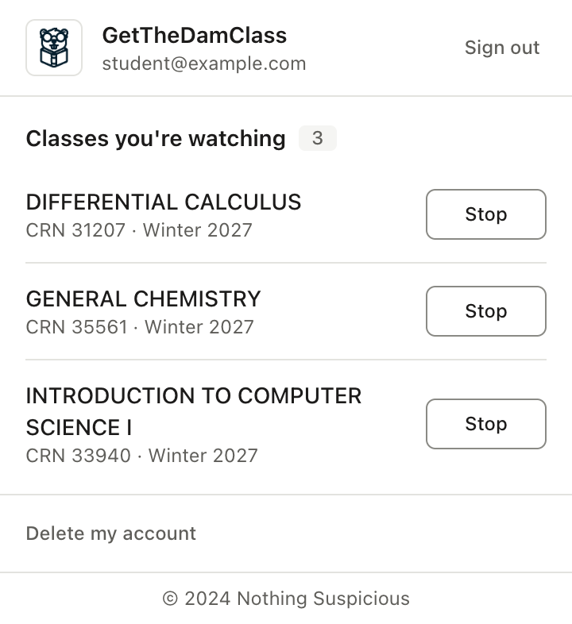

# GetTheDamClass

A Chrome extension that emails Oregon State University students when a seat opens in a class.

On [classes.oregonstate.edu](https://classes.oregonstate.edu), open a section and press **Notify me**. You get an email when a seat opens, and another if the class fills up again. **Stop alerts** turns it off, and the toolbar popup lists every class you are watching.

| On the class page | In the toolbar popup |
| --- | --- |
|  |  |

There are no passwords: you sign in with your email and a six-digit code sent to it.

Alerts work for any section with an ADD TO CART button, in a term that is open for registration, until the class's add deadline. Outside that, the page says why.

## Install

1. Download the zip from the [latest release](https://github.com/colinpannikkat/GetTheDamClass/releases/latest) and extract it.
2. Open `chrome://extensions` and turn on "Developer mode".
3. Press "Load unpacked" and pick the extracted folder.

To update from version 1, extract the new zip over the old folder and press reload on the extension's card. You sign in once more with an emailed code, and alerts from version 1 are not carried over: press "Notify me" on those classes again.

Version 1 ([v1.0.1](https://github.com/colinpannikkat/GetTheDamClass/releases/tag/v1.0.1)) is still the one in the Chrome Web Store. It signs in with a PIN and uses the [old backend](https://github.com/aj-arts/GetTheDamClass-Backend); its source is on the [`legacy` branch](https://github.com/colinpannikkat/GetTheDamClass/tree/legacy).

## Develop

You need [Node.js](https://nodejs.org) 22.23+, 24.22+ or 26.12+ and [pnpm](https://pnpm.io/installation).

```sh
pnpm install
pnpm build        # the extension is written to apps/extension/.output/chrome-mv3
pnpm typecheck
pnpm test
```

Load the built folder with "Load unpacked", as above. Turn off any other copy of GetTheDamClass first, or the class page gets two buttons.

That build talks to the real server. To try it against a server on your computer, use two terminals:

```sh
cd apps/server && pnpm dev                # the server, at http://localhost:5173
```

```sh
cd apps/extension && pnpm build:local     # written to .output/chrome-mv3-local-server
```

- Nothing is emailed locally. Sign-in codes are printed in the server's terminal.
- The first time you press "Notify me", Chrome asks whether classes.oregonstate.edu may reach your local network. Choose **Allow**.
- The local server asks the university's real class search, which every student shares, so keep your tries few.

## How it is built

| Folder | What it is |
| --- | --- |
| [`apps/extension`](apps/extension) | The extension: [WXT](https://wxt.dev), [React](https://react.dev) and [Tailwind CSS](https://tailwindcss.com). It has no background script and asks only for the `storage` permission. |
| [`apps/server`](apps/server) | A [Cloudflare Worker](https://developers.cloudflare.com/workers/) with a D1 database, at `https://api.getthedamclass.ajinkya.dev`. It sends the sign-in codes, checks the watched classes every minute and sends the alerts. |
| [`packages/shared`](packages/shared) | The API between the two, defined once with [Effect](https://effect.website)'s `HttpApi`. |
| [`marketing`](marketing) | Screenshots and the tutorial video. Not part of the pnpm workspace. |

Everything that is not user interface is written with Effect. Tests run on [Vitest](https://vitest.dev) and sit next to the file they test.

The details are in each folder's README:

- [apps/extension](apps/extension/README.md): the files, what is stored in the browser, why the sign-in form is in a frame, and what to do when the university changes its page.
- [apps/server](apps/server/README.md): running it locally, deploying, migrations, logs and email limits.
- [marketing](marketing/README.md): the screenshots and the video.

## Releasing

1. Bump `version` in `apps/extension/package.json`. The manifest takes its version from there.
2. `pnpm typecheck && pnpm test`
3. `pnpm zip` in `apps/extension`, which writes `.output/getthedamclass-<version>-chrome.zip`.
4. Attach the zip to a new GitHub release and upload it to the Chrome Web Store.
5. Update [Install](#install) above, which says which version can be installed today.

The server is deployed separately, by hand: see [apps/server](apps/server/README.md#deployment).

---
&copy; 2024 Nothing Suspicious (Colin Pannikkat, Ajinkya Gokule, David Gesl, Sarvesh Thiruppathi Ahila)
