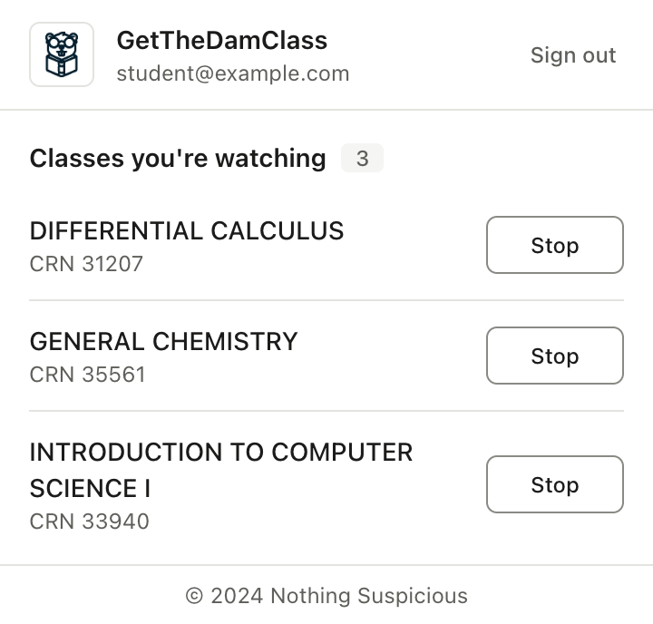

# GetTheDamClass

Class vacancy notifier Chrome extension for Oregon State University.

On [classes.oregonstate.edu](https://classes.oregonstate.edu), open a class and press **Notify me**: you get an email when a seat opens or the class fills up. **Stop alerts**, next to it, turns that off again. The toolbar popup lists the classes you are watching and lets you stop the alerts there too.

| On the class page | In the toolbar popup |
| --- | --- |
|  |  |

"Notify me" is on every section with an ADD TO CART button, in any term. Whether a class takes alerts is up to the server: its term must be open for registration, and the class's add deadline must not have passed (see `apps/server/src/termRule.ts`). When a class does not, the page says why, in the server's words.

There are no passwords. To sign in (or sign up, or get back in after forgetting everything), type your email and then the six-digit code the server emails you.

The extension talks to its own server, `apps/server` in this repository: a [Cloudflare Worker](https://developers.cloudflare.com/workers/) with a D1 database, which checks the watched classes every minute and sends the emails. It replaces the earlier backend ([GetTheDamClass-Backend](https://github.com/aj-arts/GetTheDamClass-Backend)), which ran on a private server and signed in with a PIN. The new server runs on Cloudflare at `https://api.getthedamclass.ajinkya.dev` (see [Deployment](#deployment)).

## Adding the Chrome Extension

The version you can install today is the earlier one: v1.0.1 on the [releases page](https://github.com/colinpannikkat/GetTheDamClass/releases), which is also the version in the Chrome Web Store. It signs in with a PIN and uses the old backend. The version this README describes, with sign-in by emailed code and its own server, is not released yet. Until it is, build it from source ([Building it yourself](#building-it-yourself)).

To install a release:

1. Download the latest release from the [releases page](https://github.com/colinpannikkat/GetTheDamClass/releases).
2. Extract the downloaded zip file to a location on your local machine.
3. Open Chrome and navigate to `chrome://extensions`.
4. Enable "Developer mode" by toggling the switch in the top right corner.
5. Click on the "Load unpacked" button and select the extracted folder.
6. The extension should now be added to Chrome and ready to use.

**Updating from an earlier version**, once this version is released: extract the new zip over the old folder and press the reload button on the extension's card. Versions that signed in with a PIN used the old backend, so you are signed out once (your email is filled in; ask for a code), and alerts made with them are not carried over: press "Notify me" on those classes again. If you extract to a new folder instead, or load a build of your own, Chrome treats it as a different extension: remove or turn off the old GetTheDamClass first (otherwise the class page gets two buttons).

## Building it yourself

You need [Node.js](https://nodejs.org) 22.23, 24.22 or 26.12 (or newer within that line; developed with 24) and [pnpm](https://pnpm.io/installation). Those are the versions [cf](https://developers.cloudflare.com/cf/), Cloudflare's command-line tool, supports; it builds the server.

```sh
pnpm install
pnpm build
```

The extension is written to **`apps/extension/.output/chrome-mv3`**. Load that folder in Chrome: `chrome://extensions` → enable "Developer mode" → "Load unpacked".

### Scripts

Run these in `apps/extension/`. `pnpm typecheck`, `pnpm test` and `pnpm build` also work from the repository root, where they run in every package.

| Command | What it does |
| --- | --- |
| `pnpm dev` | Development build into `.output/chrome-mv3-dev` that rebuilds and reloads as you edit, talking to the server on your computer (`http://localhost:5173`). Load that folder once with "Load unpacked". (It asks for extra permissions that WXT needs for reloading; the real build does not.) |
| `pnpm build` | Production build into `.output/chrome-mv3`, talking to the real server (`https://api.getthedamclass.ajinkya.dev`). |
| `pnpm build:local` | The same build, but talking to the server on your computer, into `.output/chrome-mv3-local-server`. See [Trying the extension against a local server](#trying-the-extension-against-a-local-server). |
| `pnpm zip` | Builds, then packs the result into a zip in `.output/` for a release or the Chrome Web Store. |
| `pnpm typecheck` | Checks the TypeScript types. |
| `pnpm test` | Runs the unit tests. |

### Running the server

`apps/server` is the Cloudflare Worker the extension talks to: sign-in by emailed code; starting, listing and stopping alerts; a check every minute that emails each watcher when a seat opens or the class fills again; and a daily cleanup.

```sh
cd apps/server
pnpm dev                       # runs the Worker locally, at http://localhost:5173
```

`pnpm dev` first brings the local database up to date (it applies `migrations/` to a SQLite file under `.cloudflare/state`), then runs the Worker in workerd, the same runtime Cloudflare uses, and reloads it as you edit. Nothing is emailed locally: every email is printed in that terminal instead. To try signing in, from a second terminal:

```sh
curl -X POST http://localhost:5173/sign-in/code -H 'content-type: application/json' \
  -d '{"email":"you@example.com"}'
# The code appears in the first terminal. Then:
curl -X POST http://localhost:5173/sign-in -H 'content-type: application/json' \
  -d '{"email":"you@example.com","code":"123456"}'
# {"token":"..."}: send it as `Authorization: Bearer ...` to the other endpoints, such as
curl http://localhost:5173/alerts -H 'authorization: Bearer ...'
```

The endpoints are listed in `packages/shared/src/Api.ts`. Subscribing (`POST /alerts` with `{"term":"202702","crn":"33940"}`) asks the university's real class search, and only works for a term that is open for registration, until the class's add deadline (see `src/termRule.ts`).

The two jobs, the check every minute and the daily cleanup, do not run by themselves locally. To run one:

```sh
curl 'http://localhost:5173/cdn-cgi/local/scheduled?cron=*+*+*+*+*'     # the check every minute
curl 'http://localhost:5173/cdn-cgi/local/scheduled?cron=0+11+*+*+*'    # the daily cleanup
```

Each answers `ok` or `exception`; what they log (one line per run, with its counts), and any alert emails, appear in the `pnpm dev` terminal. To look into the local database meanwhile, `POST` SQL as `{"sql":"SELECT * FROM classes"}` to `http://localhost:5173/cdn-cgi/local/explorer/api/d1/database/00000000-0000-4000-8000-000000000000/raw`. Both jobs ask the real university: the check about every watched class, and the cleanup for its term list (one request), so run them sparingly.

To start over, delete `apps/server/.cloudflare/state`; do so too after a change to the tables in `migrations/`. `pnpm typecheck`, `pnpm test` and `pnpm build` work there as they do in the extension; the tests use a SQLite database in Node and never reach the network.

### Trying the extension against a local server

1. Start the server: `pnpm dev` in `apps/server` (see above). Leave that terminal open; the sign-in codes appear in it.
2. Build the extension for it: `pnpm build:local` in `apps/extension`. (Or run `pnpm dev` there, which also talks to the local server and rebuilds as you edit.)
3. In Chrome, open `chrome://extensions`, enable "Developer mode", press "Load unpacked" and pick `apps/extension/.output/chrome-mv3-local-server`. Remove or turn off any other GetTheDamClass first, or the class page gets two buttons.
4. Open a class on [classes.oregonstate.edu](https://classes.oregonstate.edu) in a term that is open for registration, and pick a section with ADD TO CART.
5. Press **Notify me**, type any email address, press **Email me a code**, and copy the six digits from the server's terminal into the form. The button turns into **Watching**.
6. Open the extension's popup: the class is listed with its term. Press **Stop**, then **Sign out**.

Chrome treats `http://localhost` as secure, so a local server over plain HTTP is not blocked as mixed content. But since Chrome 142, a public website may only reach your own computer with your permission ([Local Network Access](https://developer.chrome.com/blog/local-network-access)). The popup and the sign-in form are pages of the extension and are not affected. "Notify me" and "Stop alerts" are: the content script's requests count as coming from https://classes.oregonstate.edu. So the first time you press one of them, Chrome asks whether classes.oregonstate.edu may access devices on your local network (or apps on this device); choose **Allow**. If you block it, or the prompt never shows (Chrome in automation does not show it), the button says "Couldn't reach the server", and the page's console shows *"Permission was denied for this request to access the `loopback` address space"*. Allow it again in the site's settings: the icon left of the address bar, or `chrome://settings/content/siteDetails?site=https%3A%2F%2Fclasses.oregonstate.edu`. A normal build is not affected: its server is on the internet.

Each "Notify me" on a class nobody else watches makes the local server ask the university's class system about it four times (the term list, the title, the seats and the dates). That system is shared by every student, so keep such tries few.

## How it is built

- [WXT](https://wxt.dev) builds the extension and generates `manifest.json` (from `apps/extension/wxt.config.ts` and the files in `apps/extension/entrypoints/`).
- [React](https://react.dev) and [Tailwind CSS](https://tailwindcss.com) draw the user interface.
- [Effect](https://effect.website) runs everything that is not drawing: talking to the server, storage, and error handling. The API between the two is defined once, with Effect's `HttpApi`, in `packages/shared`.
- [Vitest](https://vitest.dev) runs the tests. They sit next to the file they test (`Api.ts` → `Api.test.ts`).

## Project map

```
apps/extension/           The browser extension.
  entrypoints/            What the browser loads. WXT turns each folder into part of the extension.
    popup/                The window that opens from the toolbar icon.
      App.tsx             Picks the screen: signed out, or signed in with the list.
      ClassList.tsx       The watched classes, each with its term and its "Stop" button.
      DeleteAccount.tsx   "Delete my account", and the question it asks first.
    content/              The script added to classes.oregonstate.edu.
      index.tsx           Puts a control into every class-details panel and keeps it there.
      detailsPanel.ts     Everything we know about the page's HTML. START HERE when the
                          university changes its markup and the button disappears.
      NotifyControl.tsx   The "Notify me" button, "Stop alerts", their messages and the sign-in popover.
      fixtures/           Trimmed copies of the real page, for the tests.
    signin/               The sign-in form the class page shows in a frame (see below).
  components/             React components shared by the popup and the pages above.
    Button.tsx            A button with variants and a loading state.
    Message.tsx           An inline info, success or error message.
    TextField.tsx         A text input with its label.
    SignInForm.tsx        Signing in (or up), in two steps: the email, then the emailed code.
    cx.ts                 Tiny helper to join CSS class names.
  lib/                    Everything that is not user interface.
    domain.ts             Which class an alert is for (ClassId), and the errors only the extension has.
    termName.ts           A term's code in words: "202702" is "Winter 2027".
    Api.ts                Service: the calls to the server, on the typed client from packages/shared.
    AccountStore.ts       Service: the saved email and sign-in token, a code that was asked for,
                          and the watched classes, in the browser's extension storage.
    workflows.ts          What a user can do: requestCode, signIn, changeEmail, signOut,
                          deleteAccount, subscribe, unsubscribe, listAlerts.
    runtime.ts            Wires the real services together so effects can run.
    react.ts              Hooks that let React components run effects.
    errorMessage.ts       The sentence shown to the user for each error.
  assets/tailwind.css     The stylesheet: colours and sizes used everywhere.
  public/icons/           The extension's icons, copied into the build as they are.
  wxt.config.ts           Extension name, permissions, icons; build plugins.
  vitest.config.ts        Test setup (with vitest.setup.ts).
apps/server/              The Cloudflare Worker the extension talks to.
  src/index.ts            The Worker: plugs the server and the jobs into Cloudflare's bindings.
  src/server.ts           The whole server as one layer: API handlers, unsubscribe page, CORS.
  src/signIn.ts           Sign-in codes, and the sign-in endpoints.
  src/tokens.ts           Sign-in tokens, and the middleware that checks them.
  src/account.ts          Signing out and deleting the account.
  src/alerts.ts           Starting, listing and stopping alerts.
  src/termRule.ts         Which terms and dates take alerts: open terms, and each class's add deadline.
  src/poll.ts             The check every minute: seats, and the emails when a class opens or fills.
  src/cleanup.ts          The daily job: ended alerts, old classes, expired codes and tokens.
  src/scheduled.ts        When the two jobs run, and which one each cron trigger starts.
  src/unsubscribe.ts      The unsubscribe link in emails, and the page it opens.
  src/University.ts       Service: the university's class search, and reading its pages.
  src/Mailer.ts           Service: sending email (or printing it, locally).
  src/emails.ts           What every email says.
  src/database.ts         The database client (D1).
  src/secrets.ts          Random codes, tokens and keys, and their hashes.
  src/html.ts             For emails and pages: escaping text, naming a class, the brand colour.
  migrations/             The database tables, as SQL run in order.
  test/                   What the tests share: the server in-process, SQLite, fakes, saved university answers.
  cloudflare.config.ts    The Worker's name, settings, cron triggers and bindings for Cloudflare.
  vite.config.ts          Builds and runs the Worker, with Cloudflare's Vite plugin.
  vitest.config.ts        Test setup.
packages/shared/          What the extension and the server share, used as TypeScript source.
  src/Api.ts              The API: every endpoint, defined once with Effect's HttpApi.
  src/domain.ts           The data (Term, Crn, EmailAddress, Alert) and every API error.
```

There is no background script. The extension only needs the `storage` permission, and no access to any website beyond the content script on the class search.

### How the parts stay in step

The popup, the button on the class page and the sign-in frame all read and write the browser's extension storage (`apps/extension/lib/AccountStore.ts`): who is signed in, which classes they are watching, and how far a sign-in has got. Each of them follows it as it changes, so stopping an alert in the popup turns "Watching" back into "Notify me" on an open class page, signing in anywhere signs you in everywhere, and a code asked for in the popup can be typed in the form on the class page.

What is stored, unencrypted, until you sign out or delete your account (which removes all of it):

| Key | Value | |
| --- | --- | --- |
| `email` | `"student@oregonstate.edu"` | Who is signed in. Without a `token`, the address the sign-in form starts with. |
| `token` | `"kq3V..."` | The sign-in token the server gave this browser, sent with every request as `Authorization: Bearer`. |
| `codeRequest` | `{ "email": "...", "requestedAt": 1795075200000 }` | A code for this address was asked for at this time (milliseconds since 1970), and not used yet. The email may still be on its way, or may never come. |
| `watch:202702:student@oregonstate.edu:33940` | `true` | One key per watched class, named after the term, the account and the CRN. |

`codeRequest` is what lets the form survive being closed: Chrome closes the popup as soon as you click into your inbox to read the code, and when it opens again the form is at the code step for the address you typed. So it is saved just before the server is asked for the code, not after: the popup is often gone before the answer comes. If the server refuses or cannot be reached while the form is still open, the request is undone (`requestCode` in `apps/extension/lib/workflows.ts`):

- "A code went to this address less than a minute ago": the form stays at that address's code step, since that code may be in the inbox. If this browser asked for it, its request is put back, so that its 15 minutes do not start again.
- "We couldn't send the email": no request is kept, and the form goes back to the email step with the address filled in. The server had already replaced any earlier code for the address with the new one, then forgot the new one, so no code works.
- No answer, or one the extension does not understand: the request saved before is put back (none, or the earlier one, with its own time).

Only the request saved by that attempt is undone. If something else changed `codeRequest` while the server was answering ("Use a different email", a code asked for in another part of the extension, signing in or out), the answer changes nothing and the form says nothing about it. If the popup was closed before a refusal came, nothing is undone: the form opens at the code step, and "Send a new code" there asks again and shows why it did not work.

A request counts for 15 minutes from when it was asked for, the time a code works. After that, the first part of the extension that reads it removes it; signing in, "Use a different email" and signing out remove it straight away.

A watched class is a key of its own so that adding one is a single write and removing one a single delete. Nothing reads a list, changes it and writes it back, so changes to two different classes made at the same moment (in the popup and on a class page, say) cannot undo each other. Two changes to the same class can: the answer that is saved last wins (see the known gaps below). The account is part of the name so that an answer from the server that arrives after someone else signed in is saved for the account that asked, where the other never sees it. And the term is part of it because the university reuses CRNs from term to term: the same CRN in two terms is two classes, everywhere in the extension.

When the server answers a request with `NotSignedIn` (the token was ended: the account was deleted from another browser, or the token went unused for a year), the extension removes `token` and that account's `watch:` keys, and keeps `email`, so every part of it shows the sign-in form with the address filled in. The `watch:` keys go because the account may be gone: kept, they would show "Watching" again after signing in with the same address, to a new account without those alerts. If the account does still exist, the popup lists its alerts again when it is next opened.

Versions that signed in with a PIN also stored a `pin` key, and `watch:` keys for alerts on the old backend. The first time any part of the extension starts after an update in place, it removes both (see `AccountStore.layer`); the email stays.

Signing out forgets everything in the browser first, and only then asks the server to end the token (giving it 5 seconds), so it works with the server down and with the popup closed straight after. A token the server was not told about stays there, held by no browser, until it has gone unused for a year.

Known gaps, each needing two parts of the extension used within the time one request takes:

- A "Notify me" still waiting for the server when you sign out (in another part of the extension) saves its `watch:` key (term, email and CRN) after the sign-out, where it stays until the next sign-out.
- An answer for a class that arrives after a later change to the same class is saved over it. Press "Notify me" on a class page, then "Stop" for that class in the popup before the first answer is back, and the page can say "Watching" although the alert was stopped, until the popup is next opened.
- "Delete my account" forgets everything in the browser once the server has deleted the account. If you sign in to another account (in another part of the extension) while it waits, that sign-in is forgotten too.

The page trusts that saved list and does not ask the server when a class is opened. If an alert ended elsewhere (stopped with the link in an email or in another browser, or removed by the server's daily cleanup after the class's add deadline), the page still says "Watching" until the popup is next opened, which fetches the real list, or until "Stop alerts" is pressed, which works either way. The other way round, after a `NotSignedIn` and signing in again, a class whose alert is still on shows "Notify me" until the popup is opened; pressing it just finds the alert already there and shows "Watching".

### Why the sign-in form on the class page is in a frame

Whatever a content script draws into a web page, that page's own scripts can read, including every key typed into a field. So the email and the sign-in code are never typed into the university's page. The popover that "Notify me" opens contains an `<iframe>` showing `signin.html`, a page of the extension itself (`apps/extension/entrypoints/signin/`). The class page cannot look inside it. `apps/extension/wxt.config.ts` lists that one page under `web_accessible_resources`, for classes.oregonstate.edu only, which is what allows it to be framed there.

The frame tells the page around it three things, with `window.postMessage` (`apps/extension/entrypoints/signin/messages.ts`): "close me" (Escape was pressed, or someone signed in elsewhere), "I am this tall now", and "signed in". None of them carries what was typed. "Signed in" is what makes the button carry on and set up the alert, so only the form that was actually submitted does that: signing in through the toolbar popup while a popover is open on a class page closes the popover and subscribes to nothing. Only the frame can tell the two apart (both look the same in storage), so it is the frame that asks to be closed.

### When the university changes its page

The button is only put on the page when the script can read three things from a class's panel: the CRN, the term, and the bar that holds ADD TO CART. If one of them cannot be found the script shows nothing, rather than a button that might sign a student up for the wrong class. So after a change to the university's markup the button simply disappears.

`apps/extension/entrypoints/content/detailsPanel.ts` holds every selector, with a drawing of the page's structure at the top. Its tests run against `apps/extension/entrypoints/content/fixtures/*.html`. To refresh a fixture: open the section on classes.oregonstate.edu, and in the browser's developer tools run `copy(document.querySelector("main.panels").outerHTML)`. Paste that over the fixture and trim it the way the comment at the top of the file describes. Then run `pnpm test` and fix `detailsPanel.ts` until it passes.

## Releasing

1. Bump `version` in `apps/extension/package.json` (the manifest takes its version from there).
2. `pnpm typecheck && pnpm test`
3. `pnpm zip` in `apps/extension/`, which writes `apps/extension/.output/getthedamclass-<version>-chrome.zip`.
4. Attach the zip to a new release on GitHub, and upload it to the Chrome Web Store.

## Deployment

The server runs on the Cloudflare account that holds the `ajinkya.dev` zone (a free zone, on an account with the Workers Paid plan). Everything there was set up with `cf`, and is changed with it, from `apps/server` (`pnpm exec cf ...`, after `pnpm exec cf auth login`). Nothing deploys from CI.

| What | Name | Set in |
| --- | --- | --- |
| Worker | `getthedamclass`, at `https://api.getthedamclass.ajinkya.dev` (a custom domain), with both cron triggers. Its `workers.dev` address and preview URLs are off, so the API answers at that one address. | `apps/server/cloudflare.config.ts` |
| D1 database | `getthedamclass`, ID `8ec9fdcd-620b-414f-b468-8278130c41d0`, kept in western North America | its ID in `cloudflare.config.ts`, its tables in `migrations/` |
| Email sending domain | `getthedamclass.ajinkya.dev`; every email comes from `alerts@getthedamclass.ajinkya.dev` | set up once, below |
| Rate-limiting rule | "GetTheDamClass: limit sign-in requests per IP", on the zone | set up once, below |

### Deploying a new version

```sh
cd apps/server
pnpm exec cf deploy --dry-run   # builds and lists the bindings: MAILER must be "cloudflare", PUBLIC_URL the real address
pnpm exec cf deploy
```

`cf deploy` builds in "production" mode. Never give it `-m development`: that build prints emails instead of sending them, sign-in codes included, into the logs. If the version needs a new migration, apply it first.

### Applying a new migration

Add the file to `apps/server/migrations/`, then:

```sh
pnpm exec cf d1 migrations list 8ec9fdcd-620b-414f-b468-8278130c41d0    # what has not been applied yet
pnpm exec cf d1 migrations apply 8ec9fdcd-620b-414f-b468-8278130c41d0
```

The version already running keeps using the database until the deploy, so a migration must not break it (add columns and tables; remove things only in a later migration, once no deployed code uses them).

### Reading the logs

```sh
pnpm exec cf observability tail --worker getthedamclass    # live, one JSON line per log line
```

The server writes one line per request (method, path, status), one per check (`Checked the watched classes:`, every minute, with its counts), one per daily cleanup (`Daily cleanup done.`, at 11:00 UTC), and a warning for every email that could not be sent, with Cloudflare's reason. Workers Logs keeps them for 7 days; to look further back than the tail, open the Worker in the Cloudflare dashboard and choose **Logs**.

### Setting it up on another account

This was done once, in this order:

1. **Database.** `pnpm exec cf d1 create --name getthedamclass --primary-location-hint wnam`. Put the ID it prints in `PRODUCTION_DATABASE_ID` in `cloudflare.config.ts`, then apply the migrations as above.
2. **Email.** `pnpm exec cf email-sending subdomains create -z <zone> --name getthedamclass.<zone>`. It adds six DNS records, all under that name: three MX and an SPF record on `cf-bounce.getthedamclass.<zone>`, the DKIM key on `cf-bounce._domainkey.getthedamclass.<zone>`, and a DMARC policy on `_dmarc.getthedamclass.<zone>`. `pnpm exec cf email-sending subdomains preview -z <zone> --name getthedamclass.<zone>` shows any that are missing. `pnpm exec cf email-sending limits get` must say `"recipient_mode": "arbitrary"`: the account can send to any address (an account with no sending domain can only send to its own verified addresses).
3. **Worker.** Change the domain in `cloudflare.config.ts` (and `SENDER`, `PUBLIC_URL`), then deploy as above. The first deploy creates the custom domain's DNS record and its certificate, which takes a few minutes: until then HTTPS to it fails with a handshake error. (Here the very first deploy also stopped with "This Worker does not exist on your account" right after uploading; running it again finished it.)
4. **Rate limit.** Anyone can call `POST /sign-in/code`, which sends an email, and `POST /sign-in`, which tries a code, without signing in. The server already allows one code a minute per address and five tries per code; this rule also stops one client from sending many requests in a row. It lives in the zone, not in this repository:

   ```sh
   pnpm exec cf rulesets entrypoint update http_ratelimit -z <zone> --rules '[{
     "description": "GetTheDamClass: limit sign-in requests per IP",
     "expression": "(http.host eq \"api.getthedamclass.<zone>\" and starts_with(http.request.uri.path, \"/sign-in\"))",
     "action": "block",
     "ratelimit": { "characteristics": ["cf.colo.id", "ip.src"], "period": 10, "requests_per_period": 10, "mitigation_timeout": 10 },
     "enabled": true
   }]'
   ```

   That is 10 requests per 10 seconds from one IP address; beyond that, the address gets HTTP 429 on those paths for 10 seconds. A student sends a handful of these requests a minute, so only a script meets it; it then gets about one try a second. A free zone allows one rate-limiting rule, with 10 seconds as its only period and block time. `entrypoint update` replaces every rule in the zone's rate-limiting list, so on a zone that already has one, change that list instead (`pnpm exec cf rulesets entrypoint get http_ratelimit -z <zone>` shows it).

## How the Effect code is organised

If you have not used Effect before, this is all you need to find your way around `apps/extension/lib/`.

**An effect is a description of work.** A value of type `Effect<Success, Error, Requirements>` does nothing by itself; it describes something that, when run, either succeeds with a `Success` or fails with one of the listed `Error`s. Because the errors are part of the type, TypeScript tells you which failures you still have to handle.

Inside `Effect.gen(function*() { ... })`, read `yield*` the way you read `await`: it runs another effect and gives you its result.

**Services** are the parts that touch the outside world. There are two:

- `Api` (`apps/extension/lib/Api.ts`) sends requests to the server. It is a thin layer over the typed client Effect builds from the API in `packages/shared/src/Api.ts`: that client knows every path, payload and reply, and checks each reply against the schemas.
- `AccountStore` (`apps/extension/lib/AccountStore.ts`) reads and writes the saved email and token, the code that was asked for, and the list of watched classes.

Each is a class that names the service and lists its functions. Code asks for one with `const api = yield* Api`.

**Layers** are the implementations of a service. `Api.layer` is the real one, built on `fetch`. Tests swap in others: `Api.layerWithFetch(fakeFetch)` to test the Api itself, or `Layer.mock(Api, { ... })` to give other code a fake server.

**The runtime** (`apps/extension/lib/runtime.ts`) is where the real layers are put together, once. Anything that wants to run an effect uses it.

**Errors** each have a `_tag`, their name as a string (`"TermNotOpen"`, `"NotSignedIn"`, `"NetworkError"`, ...), so handling an error is a `switch` on `error._tag`. The server's refusals are defined once for both sides in `packages/shared/src/domain.ts`, and each carries a `message` written for the student, which the extension shows as it is. The extension's own errors (no answer from the server, an answer the API does not describe, storage failing, a bug) are in `apps/extension/lib/domain.ts`, and `apps/extension/lib/errorMessage.ts` has their sentences.

**Workflows** (`apps/extension/lib/workflows.ts`) combine the services into the things a user does. `subscribe(classId)`, for example, reads the saved token (failing with `NotSignedIn` if there is none), sends the class's term and CRN with it, and saves the class as watched by that account. The user interface calls workflows, never the services directly.

**Components run effects through three hooks** in `apps/extension/lib/react.ts`. They turn an effect into a plain object with a `status` to switch on:

```tsx
import { Button } from "@/components/Button"
import { Message } from "@/components/Message"
import type { ClassId } from "@/lib/domain"
import { errorMessage } from "@/lib/errorMessage"
import { useAction } from "@/lib/react"
import { subscribe } from "@/lib/workflows"

function NotifyButton({ classId }: { classId: ClassId }) {
  const { state, run } = useAction(subscribe)
  return (
    <>
      <Button variant="primary" loading={state.status === "loading"} onClick={() => run(classId)}>
        Notify me
      </Button>
      <Message tone="success">{state.status === "success" ? "You're on the list." : null}</Message>
      <Message tone="error">{state.status === "failure" ? errorMessage(state.error) : null}</Message>
    </>
  )
}
```

- `useAction(workflow)` gives a `run` function for clicks and form submits.
- `useQuery(() => effect, deps)` runs an effect when the component appears, for loading data.
- `useAccount()` says who is signed in and which classes they are watching (or, signed out, the email and code request the sign-in form starts from), and updates when that changes anywhere in the extension.

**In the tests** you will meet a few more Effect names. `it.effect(...)` runs a test written as an effect; its clock starts at 0 and only moves when the test says (`TestClock.adjust`, `TestClock.setTime`). `Layer.mock(Api, { ... })` is a fake server. In `apps/extension/lib/workflows.test.ts`, `Effect.forkChild` starts a workflow without waiting for it (it returns a `Fiber`, a handle to the running work, which `Fiber.join` waits for), and a `Latch` is a gate the fake server waits at until the test opens it. Together they let a test do something while a request is still unanswered.

### Adding a server call

1. Add the endpoint to `packages/shared/src/Api.ts`, with any new refusal in `packages/shared/src/domain.ts`, and implement it in `apps/server`.
2. Add a function to the `Api` service in `apps/extension/lib/Api.ts` that calls the typed client, with `settle` as its last step like the others: it adds the 30-second time limit and turns failures that are not refusals into `NetworkError` or `ServerError`.
3. Cover it in `apps/extension/lib/Api.test.ts`: the request it sends, each refusal, and a reply of the wrong shape.
4. Add a workflow in `apps/extension/lib/workflows.ts`. If it sends the saved token, wrap the call in `withToken` there, so that a `NotSignedIn` answer signs the browser out.
5. If the call has a new refusal, add it to `AppError` in `apps/extension/lib/domain.ts` and to the list in `apps/extension/lib/errorMessage.ts` that shows the server's sentence.
6. Call it from a component with `useAction` or `useQuery`.

---
&copy; 2024 Nothing Suspicious (Colin Pannikkat, Ajinkya Gokule, David Gesl, Sarvesh Thiruppathi Ahila)
