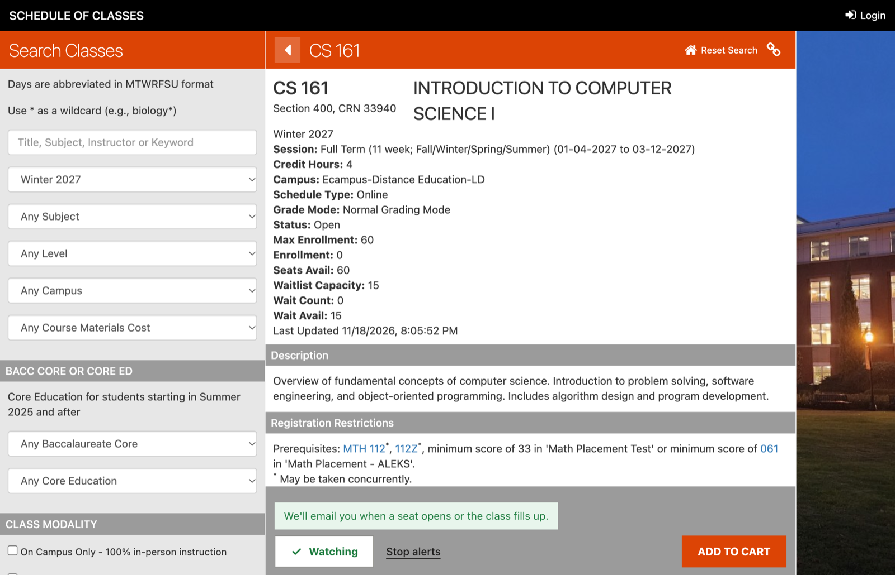
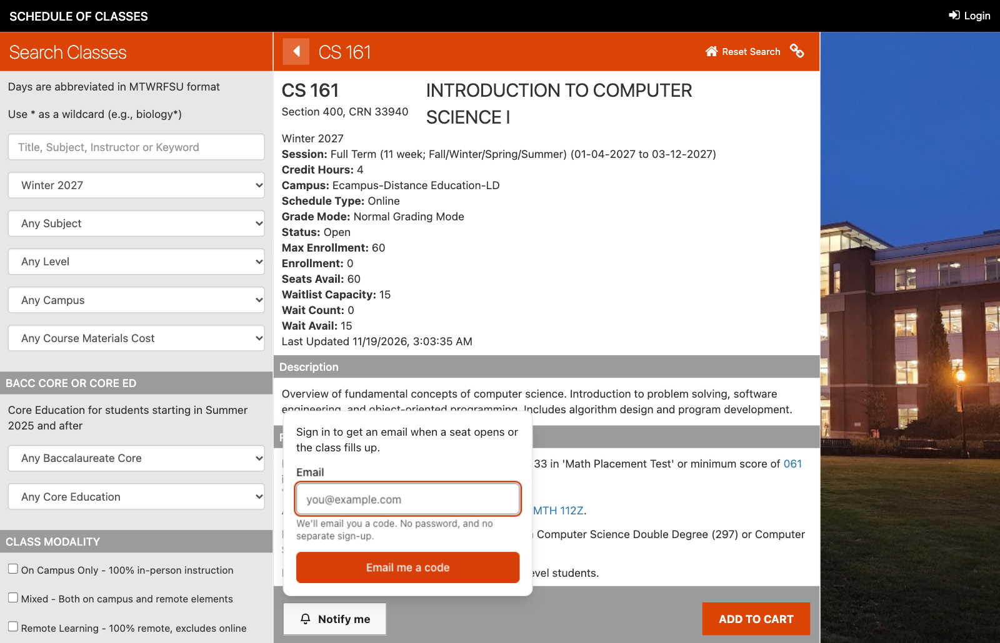
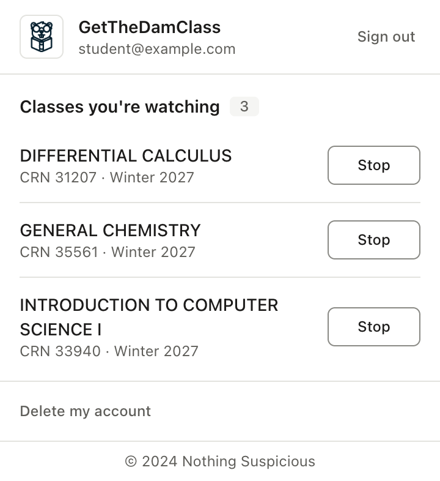
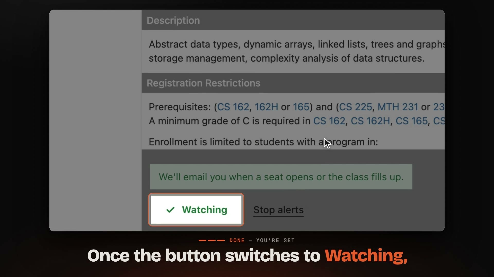
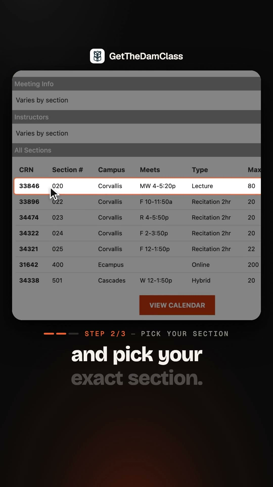

# Marketing

What is used to show GetTheDamClass to people: screenshots of the extension, and the tutorial video.

## Screenshots

`screenshots/` holds three pictures of the extension with placeholder data. The main README and the Chrome Web Store listing can use them.

| | |
| --- | --- |
|  | `class-page-watching.png`: a class being watched. |
|  | `class-page-sign-in.png`: signing in from the class page. |
|  | `popup.png`: the toolbar popup. |

## Tutorial video

A 44-second video that walks through setting up an alert: find a class, pick a section, press **Notify me**, sign in, check the popup. It comes in two cuts with the same narration and music.

<p>
<a href="https://github.com/colinpannikkat/GetTheDamClass/releases/download/tutorial-video-v1/horizontal-1080p60.mp4"></a>
<a href="https://github.com/colinpannikkat/GetTheDamClass/releases/download/tutorial-video-v1/vertical-1080x1920.mp4"></a>
</p>

The videos are kept out of git history, which they would add about 100 MB to. They are attached to the [tutorial-video-v1 release](https://github.com/colinpannikkat/GetTheDamClass/releases/tag/tutorial-video-v1):

| Video | For |
| --- | --- |
| [`horizontal-1080p60.mp4`](https://github.com/colinpannikkat/GetTheDamClass/releases/download/tutorial-video-v1/horizontal-1080p60.mp4) | YouTube, websites, slides |
| [`horizontal-4k60.mp4`](https://github.com/colinpannikkat/GetTheDamClass/releases/download/tutorial-video-v1/horizontal-4k60.mp4) | The same cut in 4K |
| [`vertical-1080x1920.mp4`](https://github.com/colinpannikkat/GetTheDamClass/releases/download/tutorial-video-v1/vertical-1080x1920.mp4) | YouTube Shorts, Instagram Reels, TikTok |

`tutorial-vid/videos/captions.srt` is the narration as timed captions, for platforms that take a caption file. Both cuts share one timing.

The class on screen (CS 261, Winter 2027) and the email address (`you@oregonstate.edu`) are examples. The recording was made against a local server, so no real account or alert is behind it.

### What is in the folder

```
tutorial-vid/
  script.md          The narration line by line, with what is on screen during each line.
  videos/            The captions and a still of each cut. Renders are written here
                     too, but git ignores them.
  assets/            What the video is made from: the two Chrome recordings
                     (3072x1728, 60 fps, no pointer), the narration with its
                     music (script-audio.wav), the icon.
  src/               The code that makes the video.
    index.tsx          Registers the two cuts.
    Horizontal.tsx     The 1920x1080 cut: framing, camera moves, intro, email card, end card.
    Vertical.tsx       The 1080x1920 cut: the same, for a phone.
    Walkthrough.tsx    The browser window: recording, camera, pointer, spotlights.
    edit.ts            The cut: which part of a recording plays when, the pointer's
                       path, what is spotlit. START HERE to retime something.
    captions.ts        Every word of the narration with its time, and the caption lines.
    components.tsx     Small shared pieces: captions, backdrop, icon, headline type.
    theme.ts           Colours, fonts, easing.
```

### Changing the video

`tutorial-vid/` is a [Remotion](https://www.remotion.dev) project: the video is React code, rendered frame by frame over real screen recordings. It uses npm and is not part of the pnpm workspace, so the root `pnpm` commands and CI leave it alone. Remotion has [its own license](https://www.remotion.dev/license), free for individuals and small teams.

```sh
cd marketing/tutorial-vid
npm install
npm run studio                 # preview and scrub both cuts in the browser
npm run render:horizontal      # writes videos/horizontal-1080p60.mp4
npm run render:horizontal:4k   # writes videos/horizontal-4k60.mp4
npm run render:vertical        # writes videos/vertical-1080x1920.mp4
```

A changed video goes out as a new release (`tutorial-video-v2`, and so on), with the links above updated to it.
